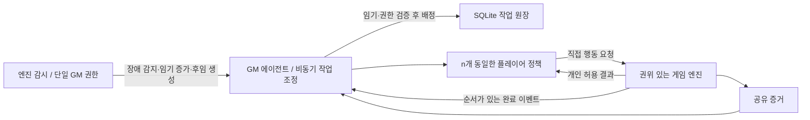

# 멀티에이전트 통합 데모

`internal_docs`의 2026-10-06 엔진 연동 회의 정리를 우선하고, 프로젝트 방향 문서의 mixed-motive / resilience 요구를 함께 구현했습니다. 논의 중인 항목은 팀의 최종 합의로 간주하지 않고 아래 구현 기본값으로 고정했습니다.

## 실행과 시연

추가 설치 없이 `python app.py` 실행 후 `http://127.0.0.1:8765/multi`에 접속합니다.

1. 인원 3, seed 42로 새 사건을 만듭니다.
2. 자동 수사를 시작합니다. 키가 없으면 구조화된 기본 정책, 키가 있으면 기존 API 어댑터를 통한 LLM 판단을 사용합니다.
3. 한 플레이어의 장애를 주입하면 공유 결과는 남고 미완료 작업이 재배정됩니다. 기본 정책은 빠르므로 장애를 확실히 시연하려면 시작 전에 작업을 배정받을 플레이어를 실패시키거나 일시 정지 후 장애를 주입하고 재개하세요.
4. 추가 장애로 한 명만 남아도 수사를 계속할 수 있습니다. 모든 플레이어가 실패하면 `waiting_for_human`으로 대기합니다.
5. 공유 기록을 저장해 작업·완료 이벤트·소유권 변경·지표를 확인합니다. 개별 관찰 도구는 플레이어 자격으로 자신의 개인 목표·증거·신념·결정 기록만 조회합니다.

사건과 모든 작업은 SQLite에 저장됩니다. 비정상 종료 시 `running`이던 사건은 서버 재시작 후 엔진이 자동 복구합니다. 정상 종료나 일시 정지로 `paused`인 사건은 기존 탭에서 재개합니다. 인증 정보는 탭의 `sessionStorage`에 보관되므로 탭을 닫으면 복원 자격이 사라질 수 있습니다. API 키는 저장하지 않습니다. 운영 배포용 계정/인증 시스템은 포함하지 않습니다.

## 구조와 정책



- 인원은 1~12, 기본 3명입니다. 시작 시 직업·성향·개인 목표 태그를 seed로 무작위 배정하며 중복을 허용합니다. 사건·물증·태그는 같은 seed에서 같습니다. 비동기 행동 순서와 LLM 출력은 완전한 재현을 보장하지 않습니다.
- 플레이어는 용의자와 별도인 조사자입니다. 플레이어가 범인인 숨겨진 적대 역할은 포함하지 않습니다.
- 동일한 정책과 기본 2d6, 3 초과 성공 규칙을 적용합니다. 직업은 능력 보너스를 주지 않습니다. 성향과 목표는 공유 판단에 영향을 줍니다. 1인용 기존 규칙은 해당 모드에만 적용됩니다.
- GM은 플레이어의 행동을 승인하지 않습니다. 독립 스레드가 관찰→판단→엔진 실행을 수행합니다. LLM 호출은 상태 잠금 밖에서 실행하고 짧은 상태 변경만 직렬화합니다. 빠른 플레이어는 느린 플레이어를 기다리지 않습니다.
- GM도 독립된 관찰→판단→명령 루프를 가진 에이전트입니다. `coordination.plan`이 공유 상태와 별도 감독 원장을 읽어 작업 배정을 제안하고, 엔진의 `coordination.command`가 현재 controller/term/token/lease와 작업 상태를 검증한 뒤 확정합니다. GM에는 정답·미발견 증거·개인 목표·개인 증거 본문이 제공되지 않습니다. 엔진 감시 루프는 GM의 판단을 기다리지 않습니다.
- GM 예외 또는 40초 무응답/권한 기한 만료 시 엔진이 이전 GM의 권한을 폐기하고 NPC로 전환한 뒤, 새 ID와 증가한 임기를 가진 후임 GM을 **같은 SQLite 트랜잭션에서** 세웁니다. 지휘 권한이 있는 GM은 정확히 하나입니다. 정상 플레이어의 진행 중인 작업과 완료 증거는 그대로 유지합니다. 후임 GM은 원장·이벤트를 재조회하고, 이전 GM의 개인 추론 메모를 복사하지 않습니다.
- GM의 모델 연결이 실패하거나 무응답이면 후임 GM은 독립된 기본 정책 에이전트로 실행합니다. 엔진이 직접 수사 판단을 대신하지 않습니다. 이전 GM의 스레드가 뒤늦게 살아나도 이전 임기·폐기된 토큰으로는 명령이나 재전송 결과를 처리할 수 없습니다. NPC화는 수동 상태 전환이며 이 버전에서 퇴역 GM의 자유 대화는 구현하지 않습니다.
- `Store.transaction`의 `BEGIN IMMEDIATE`가 같은 DB를 쓰는 서로 다른 런타임의 선출/명령도 직렬화합니다. 엔진 실행자에도 5초 lease를 두어 같은 사건의 중복 자동 실행을 막습니다. 재시작·재개 시 새 실행자가 이전 GM의 임기를 폐기하고 후임을 세웁니다. 공유 SQLite 하나를 기준으로 하는 설계이며, 서로 독립된 DB 간의 분산 합의는 포함하지 않습니다.
- GM은 미완료 장소 작업을 배정하고, 해당 장소의 모든 제외 증거가 **공유된 경우** 작업을 완료합니다. 비공개 결과를 근거로 공유 작업을 완료하지 않습니다. 의존성 필드는 계약에 포함되며 첫 버전의 8개 장소 작업은 서로 독립적입니다.
- `protect_secret`는 최초 근거 보류, `prove_innocence`는 용의자 제외 증거 공유, `steal_vault`는 맡은 금고 작업 중 소지품 확보로 개인 목표 달성을 기록합니다. 기본 정책은 비밀 보류 후 공동 수사 필요에 따라 다음 행동에서 공유합니다. 개인 목표는 이 데모의 명시적인 단순화이며 복잡한 캐릭터 서사는 후속 범위입니다.
- `SHARE_FULL`, `SHARE_PARTIAL`, `WITHHOLD`, `REQUEST`, `VERIFY`, `CHALLENGE`, `INVESTIGATE`, `STEAL`, `ACCUSE`를 엔진 행동으로 제공합니다. REQUEST/VERIFY/CHALLENGE 메시지는 증거 ID와 송수신자·범위가 있는 구조화된 기록입니다. 자유 발화와 거짓 증거 생성은 지원하지 않습니다. VERIFY는 접근 가능한 공식 증거를 재조회하며, 별도 확률적 진위 추론은 하지 않습니다.
- 기본 정책은 가능한 행동 중 조사·공유·보류·개인 목표·최종 지목을 선택하고 팀/개인/정보/비용/위험 요소 및 이유를 기록합니다. utility는 설명용 요소이며 학습된 최적화 점수나 Bayesian 모델이 아닙니다. LLM 정책도 같은 행동 계약과 엔진 검증을 거칩니다.
- 플레이어 실패 정책은 task-only recovery입니다. 엔진은 기술 장애 플레이어를 살아 있는 NPC로 표시하고 미완료 소유권을 해제하며, 현재 GM 에이전트가 재배정합니다. 개인 증거·목표·신념은 DB에 봉인해 두고 다른 플레이어에게 승계하지 않습니다. 살아 있는 플레이어가 같은 장소를 다시 조사해 미공유 증거를 획득할 수 있습니다.
- 워커 예외 또는 40초 무응답으로 실패를 감지합니다. 작업 세대 번호로 늦게 도착한 이전 담당자의 행동을 거부합니다. 개별 모델 요청은 기존 어댑터의 30초 제한을 사용합니다. 자동 실행의 행동 예산을 소진하면 `paused`로 전환하여 명시적으로 재개할 수 있습니다.

## HTTP 계약

모든 요청은 JSON POST이며 `X-GM-Client: local`이 필요합니다. HTTP 서버는 localhost에서만 실행합니다.

| 경로 | 입력 | 응답 / 권한 |
| --- | --- | --- |
| `/multi/start` | `n`, `seed` | `id`, `gm_token`, `agent_credentials`, 공유 `state` |
| `/multi/observe` | `id`, `token`, 선택 `agent_id` | GM 공유 상태 또는 해당 플레이어의 허용 관찰 |
| `/multi/action` | `id`, 플레이어 `token`, `agent_id`, `request` | 엔진 확정 결과와 해당 플레이어의 관찰 |
| `/multi/run` | `id`, GM `token`, 선택 API 설정 | 즉시 공유 상태 반환, 백그라운드에서 자동 실행 |
| `/multi/pause` | `id`, GM `token` | 신규 자동 행동 중지; 이미 판단 중인 행동은 완료될 수 있음 |
| `/multi/fail` | `id`, GM `token`, `agent_id` | 장애 주입·미완료 작업 재배정 |
| `/multi/export` | `id`, GM `token` | 공유 상태·이벤트·지표만 포함하는 기록 |
| `/multi/fail-gm` | `id`, 관제 `token`, 대상 `term` | 기존 GM NPC 전환·권한 폐기·후임 선출; 동일 이전 임기의 중복 장애 요청은 재선출하지 않음 |
| `/multi/controller` | `id`, 관제 `token` | 통합 담당자용 현재 GM의 별도 controller 자격; 공개 내보내기에는 포함하지 않음 |
| `/multi/gm/observe` | `id`, `controller_id`, `term`, `controller_token` | 현재 GM 전용 공유 상태 + 감독용 소유 ID |
| `/multi/gm/command` | `id`, `request` | controller 자격, `command_id`, 배정 목록, 이벤트 cursor를 검증·확정 |

기존 `gm_token`은 호환성을 위해 이름을 유지한 **사람의 관제 권한**입니다. 실제 GM 에이전트는 별도 회전 가능한 `controller_token`과 임기를 사용합니다. 따라서 GM이 교체되어도 브라우저 관제는 유지되고, 이전 에이전트의 지휘 권한은 유지되지 않습니다.

행동 예:

```json
{
  "action_id": "unique-request-1",
  "agent_id": "agent-1",
  "task_id": "room-0",
  "generation": 1,
  "action": "INVESTIGATE",
  "evidence_ids": [],
  "reason": "할당된 장소의 자료를 확인한다",
  "utility": {"team": 1, "private": 0, "information": 1, "cost": 1, "risk": 0}
}
```

동일 `action_id`와 동일 요청은 저장된 결과를 반환하며 재실행하지 않습니다. 같은 ID에 다른 내용이 오면 거부합니다. 조사는 현재 소유권·작업 세대를 확인합니다. 최종 지목은 동일 상태 잠금에서 검증하므로 종료 후 다른 지목은 실행되지 않습니다.

완료 이벤트는 `game_id`, `action_id`, `agent_id`, `task_id`, `status`, `shared_evidence_ids`, `seq`, `timestamp`를 포함합니다. 이벤트 원장은 DB에 보존되며 관찰 API로 전체 재조회할 수 있습니다. 수신자는 `seq`/`action_id`로 중복을 제거합니다. GM 이벤트와 공개 기록에는 정답·미발견 증거·개인 관찰·개인 판단 이유·인증 토큰이 없습니다. 에이전트 자격은 다른 에이전트 또는 GM 조회에 사용할 수 없습니다.

## engine proposal 대응

`internal_docs/A_engine_proposal.docx`의 A09/A10/A11을 이번 승계 구조의 기준으로 삼았습니다.

| 제안 | 반영 |
| --- | --- |
| A05/A06 감독 결과·정보 소유 | 후임 GM 전용 감독 조회에서 소유자별 획득 정보 ID 확인. 개인 본문·목표·정답은 배제하고 플레이어 공유 조회와 구분 |
| A09 기술 장애 NPC 전환 | 플레이어와 GM의 기술 장애를 NPC 전환으로 기록. 추리 오답 사망/시체 감쇠는 별도 후속 범위 |
| A10 controller/term·대리 GM | 엔진이 유일한 controller와 증가하는 term을 저장. 권한 토큰 폐기·lease 검증·원자적 선출·지연 명령 거부. 현재 GM의 `operation: END` 종료 요청 접점 |
| A11 저장·재조회·재시작 | 트랜잭션 저장, 순서 있는 이벤트, 후임의 원장 재조회, 비정상 종료된 실행 자동 복구 |

이 변경은 GM 승계와 엔진의 장애 처리에 집중합니다. A02의 이동→탐색→추리 단계별 전원 소비/전환 계약, A08의 정상 플레이어 응답 큐, A09의 시체 처리 전체를 구현한 것으로 간주하지 않습니다.

## 검증과 제한

`test_coordination.py`는 GM 예외·무응답 이후 후임의 사건 해결, 이전 임기의 지연 명령과 cached 재전송 거부, 동시 선출에서 한 명만 당선, 감독용 소유 ID/공유 정보 경계, 재시작 후 원장 복구를 검증합니다. 브라우저에는 GM 장애 주입·현재 임기·NPC 이력·승계 횟수를 표시합니다.

`python -m unittest discover -v`는 기존 게임 회귀 검증과 seed/가변 인원, 정보 경계, 자격 검증, 행동 멱등성, 작업 세대, 공유 범위, 장애 후 증거 보존, 한 명으로 사건 해결, 저장 복원, 느린 플레이어와 병렬 진행, 모델 오류 대체를 검증합니다.

관제에는 행동 수·평균 지연·공유/부분 공유/보류·재배정·완료 작업·활성 인원·종료 시간이 표시됩니다. 이벤트 timestamp와 소유권 로그로 장애 전후 처리량을 분석할 수 있습니다. 개인 목표 달성과 구조화 결정 기록은 해당 플레이어 관찰에만 있습니다. 전체 과정의 비교 실험·H1/H2/H3 통계 검증·웹훅 이벤트 전송·신규 플레이어 합류·개인 상태 승계 정책은 구현 범위에 포함하지 않았습니다. 실제 LLM의 공동 목표 달성과 유틸리티 기록 품질은 모델과 출력에 따라 달라지며, API 연결은 사용자 키로 확인해야 합니다.

서버 DB에는 숨겨진 정답·개인 상태·인증 토큰이 포함됩니다. 공유할 때는 관제의 **공유 기록 저장**을 사용하세요.
